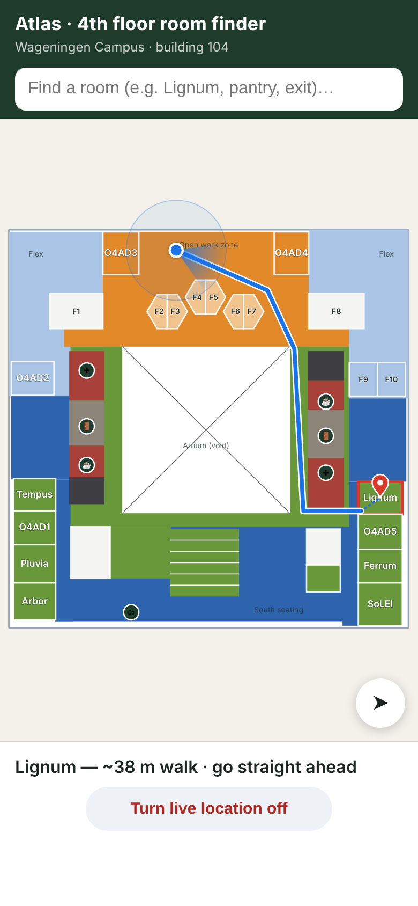
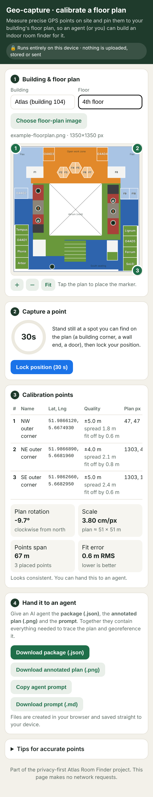

# Atlas Room Finder

**A privacy-first indoor room finder that runs entirely in your phone's browser.**
Your location never leaves your device: there is no server, no account, no tracking.

Search a room, turn on live location, and follow a walking route on a map that turns with you, like car navigation but indoors. Built for the 4th floor of the Atlas building (104) at Wageningen Campus, and designed so **anyone can make one for their own building** from a floor plan and a few GPS measurements.

### Try it

| | Live link | What it is |
|---|---|---|
| 🧭 **Room finder** | **<https://atlasroomfinder.netlify.app/>** | The Atlas 4th-floor room finder. Open it on your phone. |
| 📍 **Geo-capture tool** | **<https://geo-capture-tool.netlify.app/>** | Measure precise GPS points (30 s lock) and pin them to *your* building's floor plan |

<p align="center">
  
  
  
</p>

---

## 🔒 Privacy by design

Most indoor-navigation products work by sending your position to a central service. This one doesn't. Your position is computed and used on your own device, and that's where it ends.

| | Typical indoor navigation | Atlas Room Finder |
|---|---|---|
| Where your position is computed | Vendor's server / beacons backend | **In your browser** |
| Position sent over the network | Yes, continuously | **Never** |
| Location history stored | Often, server-side | **No**. Nothing kept after you turn it off |
| Account / sign-in required | Usually | **No** (Outlook is optional) |
| Analytics, ads, trackers | Common | **None** |
| Third-party scripts | Many | **None** in the browser*<br><sub>*Only inside Microsoft Teams: Microsoft's own TeamsJS library, integrity-pinned</sub> |
| Backend to trust or breach | Yes | **None**: static files only |

**How you can check this yourself**
- The whole app is **one HTML file** ([`index.html`](index.html)) with no build step and no dependencies. Read it.
- Open your browser's developer tools → *Network* while using the app. With location on, you'll see **zero requests**.
- The only network calls in the code are to Microsoft (`login.microsoftonline.com`, `graph.microsoft.com`) for the **optional, off-by-default** Outlook calendar feature. They fetch your meetings and never send a location.

See [PRIVACY.md](PRIVACY.md) for the full data-flow description.

---

## Features

- **Room search** for meeting rooms, project rooms (O4AD1–5), focus rooms (F1–F10) and facilities (pantries, exits, first aid).
- **Live location** that fuses three sensors on-device:
  - **GPS:** accuracy-weighted, with jumpy fixes rejected.
  - **Step counting:** from the accelerometer (pedestrian dead reckoning).
  - **Compass heading:** smoothed.

  A small Kalman-style filter combines them, so the dot moves smoothly when you walk and doesn't drift while you stand still.
- **Heading-up navigation (➤):** the map rotates with you, keeps you in the lower part of the screen, and auto-zooms so the destination stays visible. Pinch to zoom manually.
- **Walking routes** that go *around* the atrium void, stair/lift cores and closed rooms (grid-based Dijkstra with path smoothing).
- **Map constraints:** the position can't end up inside the atrium or a core.
- **Optional Outlook integration:** routes you to your next meeting's room. Off until an Entra app ID is configured. Try it without sign-in: `#calendar-demo`.
- **Microsoft Teams app:** the same page as a personal tab ([`teams/`](teams)).
- No network needed once the page has loaded. No install, no app store.

## Use it

Host the files on any static HTTPS host. Location and motion sensors require HTTPS.

- **Netlify Drop:** drag the folder onto <https://app.netlify.com/drop>.
- **GitHub Pages:** Settings → Pages → deploy from the `main` branch.

Open the page on your phone, tap **Turn live location on**, search a room, and hold the phone flat in front of you.

Handy links:
- `…/#lignum`, `…/#f5`: open with a room selected.
- `…/#demo`: click the plan to simulate a position (desktop testing).
- `…/#calendar-demo`: made-up meetings to try the calendar flow.
- `…/#privacy`: the in-app privacy note.

## Make one for your building

You need a floor-plan image and 10 minutes on site.

1. Open the **geo-capture tool** on your phone: **<https://geo-capture-tool.netlify.app/>** (or host [`tools/geo-capture.html`](tools/geo-capture.html) yourself over HTTPS). Then load a photo or screenshot of the floor plan.
2. Stand at **3–4 outer corners** of the building. At each one, tap **Lock position (30 s)**, then tap the same spot on the plan. The tool averages the GPS fixes and rejects outliers, and fits the plan's **scale and rotation** with an error estimate.
3. Export the **package (.json)**, the **annotated plan (.png)** and the **agent prompt**, and hand them to an AI coding agent. They contain everything needed to trace the plan and georeference it.

<p align="center"></p>

The geo-capture tool is also privacy-first. It makes **no network requests**, keeps points only in memory, and creates the export files directly on your device.

Full guide: [docs/ADAPT-TO-YOUR-BUILDING.md](docs/ADAPT-TO-YOUR-BUILDING.md).

## Repository layout

```
index.html                 the room finder (single self-contained file)
tools/geo-capture.html     30 s GPS lock + floor-plan pinning + agent export (hosted: geo-capture-tool.netlify.app)
teams/                     Microsoft Teams app package (manifest + icons)
docs/                      guide, example floor plan, screenshots
PRIVACY.md                 what data exists, where it lives, who can see it
```

## Limitations (honest ones)

- Phone GPS indoors is typically accurate to **±5–20 m** and can't tell floors apart. Step counting and map constraints help, but this is not centimetre-level positioning.
- Step direction assumes the phone is held flat, pointing the way you walk.
- The floor plan was traced from the wall sign, so room shapes are approximate. Door positions are inferred, and routes enter a room from its nearest wall.
- Inside Teams mobile, compass and step sensors may be unavailable, depending on the Teams webview. Teams desktop has no GPS.

## License

[MIT](LICENSE). The floor-plan geometry is a hand-drawn approximation for wayfinding, not an official building drawing.
